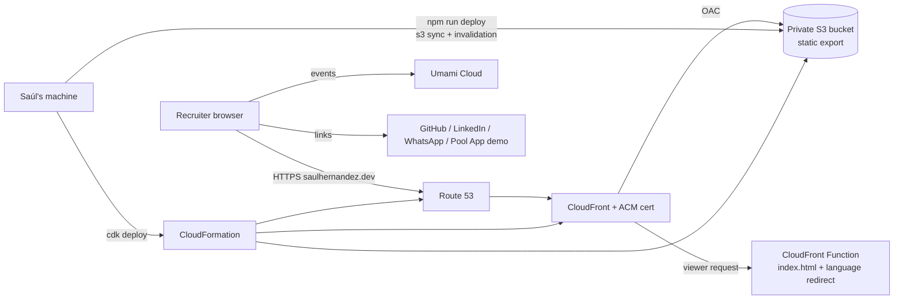

# Architecture: Saúl Hernández Portfolio

Status: Complete

## Platforms

- Web only, mobile-first, static site. No server runtime, no API.

## Stack

- Frontend: Next.js (App Router) with `output: 'export'`, React, TypeScript strict, Tailwind CSS.
- Backend: none. All pages are pre-rendered HTML at build time.
- Mobile: none (responsive web).
- Infrastructure: AWS CDK v2 in TypeScript.
- Analytics: Umami Cloud (free tier, cookieless) via one script tag + `data-umami-event` attributes on CTAs.

## Repo structure

Public GitHub repo `sahc1987/portfolio`, npm workspaces:

```text
portfolio/
├── site/                    # Next.js static site
│   ├── app/
│   │   ├── [locale]/        # /en and /es, generated with generateStaticParams
│   │   │   ├── layout.tsx
│   │   │   └── page.tsx
│   │   └── page.tsx         # root: picks language and redirects
│   ├── components/
│   ├── content/
│   │   ├── types.ts         # one Content type for both locales
│   │   ├── en.ts
│   │   └── es.ts
│   ├── public/
│   │   └── cv/              # CV_Saul_Hernandez_EN.pdf, CV_Saul_Hernandez_ES.pdf
│   └── next.config.ts
├── infra/                   # AWS CDK app
│   ├── bin/portfolio.ts
│   └── lib/portfolio-stack.ts
├── scripts/deploy.sh        # build, s3 sync, invalidation
└── *.md                     # the 8 foundation docs + README + CLAUDE.md
```

## Hosting and environments

- Local dev: `next dev`; prod-like preview: `next build` + static server over `site/out`.
- Prod only: `https://saulhernandez.dev` (apex) and `www` redirecting to apex.
- AWS resources (one CDK stack):
  - Route 53: domain registered in Route 53, hosted zone, A/AAAA alias records to CloudFront.
  - ACM certificate in `us-east-1` (required by CloudFront), DNS-validated.
  - S3 bucket: private, block all public access, versioning on, accessed only through CloudFront Origin Access Control.
  - CloudFront distribution: HTTPS only, HTTP/2+3, compression, response headers policy (security headers, see SECURITY.md).
  - AWS Budget: USD 5/month alarm with email notification.
  - CloudFront Function (viewer request): appends `index.html` to directory paths; on `/` reads `Accept-Language` and redirects to `/es/` or `/en/` (default `/en/`).
- Deploys: `npm run deploy` from Saúl's machine. No CI.
  1. `next build` (static export to `site/out`)
  2. `aws s3 sync site/out s3://<bucket> --delete` with long cache for hashed assets, `no-cache` for HTML
  3. `aws cloudfront create-invalidation --paths "/*"`

## Auth provider

- None. Public site, no login.
- AWS access for deploys: Saúl's local AWS CLI profile (IAM Identity Center or a dedicated deploy IAM user with least privilege, see SECURITY.md).

## External integrations and APIs

- Umami Cloud: analytics script, loaded from Umami's domain.
- Outbound links only: GitHub, LinkedIn, `mailto:`, WhatsApp (`wa.me`), Complete Pool App demo.
- No third-party fonts at runtime: fonts self-hosted via `next/font`.

## Config and env vars

| Variable                                        | Where        | Purpose                                                     |
| ----------------------------------------------- | ------------ | ----------------------------------------------------------- |
| `NEXT_PUBLIC_SITE_URL`                          | site build   | Canonical URLs, sitemap, Open Graph                         |
| `NEXT_PUBLIC_UMAMI_WEBSITE_ID`                  | site build   | Umami site ID (public by design)                            |
| `AWS_PROFILE`                                   | deploy / CDK | Local AWS credentials profile                               |
| `PORTFOLIO_BUCKET`, `PORTFOLIO_DISTRIBUTION_ID` | deploy       | Read from CDK stack outputs at deploy time, never hardcoded |

`.env.example` committed; real `.env*` files git-ignored.

## Diagram



## Key decisions with reasons

- **Next.js static export over SSR**: content changes rarely; static HTML is fastest and costs pennies. Same stack as Complete Pool App, so it reinforces his main skill.
- **Locale routes (`/en`, `/es`) via `generateStaticParams`**: Next's built-in `i18n` config and middleware do not work with `output: 'export'`, so locales are path segments and the redirect lives in a CloudFront Function.
- **Two root layouts + global 404**: `app/[locale]/layout.tsx` sets `<html lang>` per locale; `app/(root)/` holds the `/` fallback redirect for local dev; `app/global-not-found.tsx` (experimental flag) renders the bilingual 404.
- **Hash-based CSP at build time**: the export has inline scripts, so a post-build step hashes them into a per-page CSP meta tag instead of allowing `unsafe-inline` (see SECURITY.md).
- **cdk-nag v3** runs as a CDK validation plugin; every acknowledged finding has a reason in the stack.
- **`images.unoptimized: true`**: the Next image optimizer needs a server; images are pre-sized at build time instead.
- **Typed content files per locale**: `en.ts` and `es.ts` both satisfy one `Content` type, so `tsc` fails the build if Spanish is missing a field. Directly targets the EN/ES drift risk in the PRD.
- **S3 + CloudFront + CDK over Amplify**: more setup, but reproducible infrastructure and a real AWS talking point in interviews.
- **Local deploy script, no CI**: matches Saúl's current standard; can move to GitHub Actions later without changing the infra.
- **Prod only, no staging**: a one-page static site; local `next build` preview covers what staging would.
