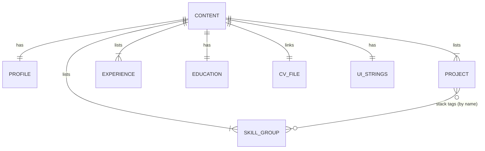

# Database: Saúl Hernández Portfolio

Status: Complete

## Engine and hosting

- No database engine. The site is a static export with no runtime data.
- Source of truth: typed TypeScript content files in git (`site/content/en.ts`, `site/content/es.ts`).
- Published copy: the built HTML in the private S3 bucket.
- Analytics data lives in Umami Cloud, outside this repo.

## ORM / query layer

- None. Components import the content object for the current locale: `getContent(locale)` returns `Content`.
- No fetching at runtime; everything is resolved at build time.

## Entities with key fields

Defined once in `site/content/types.ts`; both locale files must satisfy them.

| Entity       | Key fields                                                                                                                                                                                               |
| ------------ | -------------------------------------------------------------------------------------------------------------------------------------------------------------------------------------------------------- |
| `Profile`    | name, headline, pitch, location, availability, email, linkedinUrl, githubUrl, whatsappNumber (digits only, used for wa.me links)                                                                         |
| `Project`    | slug, title, kind (`client` \| `internal` \| `personal` \| `learning`), summary, problem, built (string[]), hardParts (string[]), stack (string[]), links { demo?, repo? }, diagram, diagramLabel, note? |
| `Experience` | slug, company, role, location? (only when known), start, end (null = present), highlights (string[]), stack (string[])                                                                                   |
| `SkillGroup` | slug, label, skills (string[])                                                                                                                                                                           |
| `Education`  | institution, degree, start, end                                                                                                                                                                          |
| `CvFile`     | locale, path, label                                                                                                                                                                                      |
| `UiStrings`  | nav labels, section titles, CTA labels, hero strings, About story + info card, kind labels, case study labels, toggles, footer                                                                           |
| `Content`    | profile, projects[], experience[], skills[], education[], cv, ui                                                                                                                                         |

## Relationships

## Indexes and constraints

- No indexes (no queries).
- Constraints enforced by TypeScript and one content test:
  - `en.ts` and `es.ts` are both typed `Content`: a missing field fails `tsc`.
  - Same project, experience and skill-group `slug`s, in the same order, in both locales.
  - Project links: `demo` only allowed when `kind !== 'internal'` (CentralDesk never gets a link).
  - `kind: 'learning'` projects must show the learning label (Hospital App).
  - Dates are ISO `YYYY-MM`, or `YYYY` when the CV has no month; `end` is null or after `start`.
  - Order of projects and experience is the array order in the locale files.
  - Every `CvFile.path` exists under `site/public/cv/`.

## Migrations strategy

- No schema migrations. A change to `types.ts` is a breaking change made in one commit together with both locale files, so `tsc` stays clean.

## Seed data

- Initial content comes from the current CV (EN and ES, updated Oct 23 2026) and the project facts already documented.
- CV PDFs exported from `CV_Saul_Hernandez_EN.docx` and `CV_Saul_Hernandez_ES.docx`.

## Soft delete / audit trail

- Not applicable. Git history is the audit trail; removing a project is a commit.

## Backups and retention

- Content: git (GitHub remote) is the backup.
- Hosting: S3 versioning on; noncurrent versions expire after 7 days (lifecycle rule in CDK). Rollback = redeploy an earlier git commit, or restore objects within 7 days.
- Analytics: retained per Umami Cloud free tier policy; no export required.
