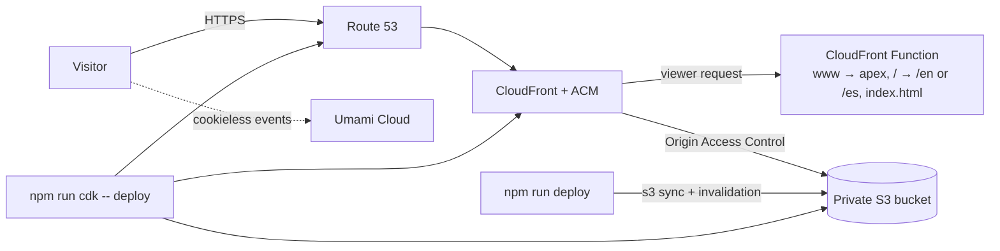

# Saúl Hernández · Portfolio

Bilingual (EN/ES) portfolio and resume for recruiters hiring full stack developers. A Next.js static export served from a private S3 bucket through CloudFront, with every AWS resource defined in CDK.

**Live:** `https://saulhernandez.dev` (once deployed)

## What's on the page

- Hero with pitch, "View my work" / "Contact me", and the stack I ship with
- About me with an info card (location, email, WhatsApp link, languages, availability)
- Four projects, each honestly labeled (client, internal tool, personal, learning) with an architecture diagram and an expandable case study
- Experience timeline, skills, education, and EN/ES CV downloads

## Architecture



| Layer    | Choice                                                                                |
| -------- | ------------------------------------------------------------------------------------- |
| Site     | Next.js 16 (App Router, `output: 'export'`), React 19, TypeScript strict              |
| Styling  | Tailwind CSS 4 on design tokens (`site/styles/tokens.css`), dark-first                |
| Content  | Typed `site/content/en.ts` and `es.ts`; `tsc` fails if a locale is missing a field    |
| Security | Build-time hash CSP per page, HSTS, frame denial, private bucket, SSO-only AWS access |
| Infra    | AWS CDK (S3, CloudFront, CloudFront Function, ACM, Route 53, Budget) + cdk-nag        |
| Tests    | Vitest + Testing Library, CDK assertions, Playwright + axe (WCAG 2.2 AA)              |

Details: [ARCHITECTURE.md](ARCHITECTURE.md) · [SECURITY.md](SECURITY.md) · [DESIGN_SYSTEM.md](DESIGN_SYSTEM.md) · [TESTING.md](TESTING.md)

## Run it locally

Requires Node 24 (see `.nvmrc`; Node 22.13+ works).

```bash
npm ci
npm run dev            # http://localhost:3000/en/
npm run build          # static export to site/out (adds the CSP meta tags)
npm run preview        # serves site/out on http://localhost:4173
```

## Edit content

All text lives in `site/content/en.ts` and `site/content/es.ts`. Change both in the same commit; `npm run typecheck` and the content tests catch a missing or mismatched field. CV PDFs live in `site/public/cv/`.

## Check

```bash
npx playwright install # first time only
npm run check          # typecheck, lint (ESLint, shellcheck, markdownlint), format, unit + E2E + axe
```

## Deploy

One-time AWS setup (on your machine; keys never leave it):

1. Root account MFA on; enable IAM Identity Center and create an admin user with MFA.
2. `aws configure sso --profile portfolio`, then `aws sso login --profile portfolio`.
3. Register `saulhernandez.dev` in Route 53 (this creates the hosted zone).
4. Copy `.env.example` to `.env` and fill it in.
5. `export CDK_DEFAULT_ACCOUNT=<your account id>` then `npm run cdk -- bootstrap` and `npm run cdk -- deploy`.

Every release, from a clean `main`:

```bash
npm run deploy         # check, audit, build, s3 sync, CloudFront invalidation
```

## Project docs

[PRD](PRD.md) · [Architecture](ARCHITECTURE.md) · [Database](DATABASE.md) · [Security](SECURITY.md) · [Design system](DESIGN_SYSTEM.md) · [Code style](CODE_STYLE.md) · [Testing](TESTING.md) · [Agents](AGENTS.md)
